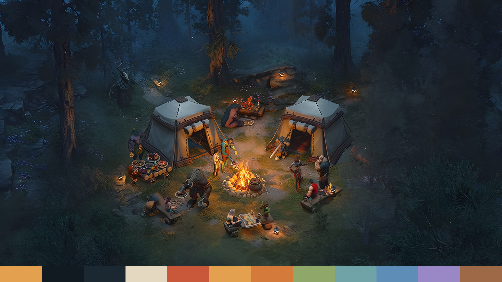

# WoW Forever: Campfire theme for Omarchy

A night camp in the pines from the *World of Warcraft: Forever* art: two
canvas tents, a cookfire, and a party settling in for the evening. Campfire
amber on the blue-black of the forest canopy, with the tents' lamplit canvas
for text.



## Install

From a checkout:

```bash
./install.sh --apply
```

That copies the theme into `~/.config/omarchy/themes/wow-forever-campfire` and
applies it. It appears in the picker as **Wow Forever Campfire**, and you can
come back to it any time with:

```bash
omarchy theme set wow-forever-campfire
```

## The wallpaper

The source art is only 1280x540, so the background is rebuilt at 5120x2160:
a 4x Real-ESRGAN upscale, with a little of a plain Lanczos resize blended back
so the grass and pine needles keep their grain, then a light sharpen. The 21:9
frame is kept whole: on 16:9 and 16:10 screens Omarchy crops around the
campfire, and ultrawides get the full clearing.

## Palette

| Role | Colour | |
|------|--------|--|
| Accent | `#E3A04F` | campfire amber |
| Background | `#121A21` | forest canopy at night |
| Foreground | `#E4D8C0` | lamplit tent canvas |
| Red | `#C9583A` | embers |
| Blue | `#5E8DB8` | dusk between the trees |
| Magenta | `#9A88C6` | wildflowers on the left bank |
| Green | `#8FA86A` | moss in the clearing |
| Icons | `Yaru-wartybrown` | |

See [`colors.toml`](colors.toml) for the full set.

## Rebuilding the wallpaper

The repository ships the finished background, so this is only needed if you
want to change it. Needs ImageMagick 7, curl, unzip and a Vulkan-capable GPU;
the script downloads the Real-ESRGAN binary into `tools/` on first run.

```bash
./build-wallpapers.sh
```

## Credits

Artwork © Blizzard Entertainment, Inc. This is an unofficial fan theme, not
affiliated with or endorsed by Blizzard Entertainment. The MIT licence covers
the scripts and palette only; see [`assets/SOURCES.md`](assets/SOURCES.md).
